# Hi, I'm Indra Prasetya 👋

### Senior Software Engineer | Backend Engineering | DevOps

Software Engineer with 12+ years of experience building
backend systems, enterprise applications, and scalable
technology solutions.

My engineering experience spans backend development,
database engineering, telecommunications systems,
infrastructure automation, and DevOps practices.

Currently expanding my expertise in cloud-native
infrastructure, Kubernetes, observability, and
open-source engineering.

I enjoy building practical engineering solutions,
experimenting with self-hosted infrastructure,
and contributing to the open-source community.

---

## 🚀 About Me

- 🔧 Backend engineering, database engineering, and enterprise systems.
- 🏗 Infrastructure automation, DevOps, and Linux/networking.
- ☁️ Expanding into cloud-native, Kubernetes, and observability.
- 💼 LinkedIn: [indraoverflow](https://www.linkedin.com/in/indraoverflow/)
- 📫 Reach me via GitHub issues or LinkedIn.

---

<!-- AGENTDIET:START -->
## 🧪 Building in the open: AgentDiet

<picture>
  <source media="(prefers-color-scheme: dark)" srcset="./assets/agentdiet-dark.svg">
  <source media="(prefers-color-scheme: light)" srcset="./assets/agentdiet-light.svg">
  
</picture>

<p align="center">
  <a href="https://github.com/qansaid/agentdiet/releases/latest"></a>
  <a href="https://github.com/qansaid/agentdiet/blob/main/LICENSE"></a>
  <a href="https://github.com/qansaid/agentdiet/blob/main/go.mod"></a>
  <a href="https://github.com/qansaid/agentdiet/actions/workflows/ci.yml"></a>
</p>

Every AI coding agent loads a set of instruction files **on every request**, before you type anything: `AGENTS.md`, `CLAUDE.md`, `.cursorrules`, `copilot-instructions.md`. They grow by accretion: a rule per incident, a table per architecture decision. Then thousands of tokens of stale policy are paid for on every prompt.

**AgentDiet** is a single static Go binary that measures that bill, shows what to cut, and enforces a budget in CI. No account, no API key, no network calls.

| Aspect | Detail |
| --- | --- |
| **The blind spot** | A 40 KB skill costs nothing until it is opened. A 40 KB `AGENTS.md` is paid for on every request, and tools that report one total cannot tell the two apart. |
| **The measurement** | Four tiers kept separate (always-on, scoped, on-demand, config), plus verbatim duplicates, ≥60% near-duplicates, oversize files and the declared MCP tool surface. |
| **The gate** | `agentdiet --max-tokens 4000` exits 1 when the always-on tax grows, so the number can only shrink on purpose. |

<details>
<summary><b>See a real report</b>: simulated repository, verbatim output</summary>

<br>

```text
$ agentdiet . --top 10

ALWAYS-ON   paid on every request, before you type
   3,118   1.56%   290 L  CLAUDE.md
   3,086   1.54%   285 L  AGENTS.md
     298   0.15%    23 L  .cursorrules
     268   0.13%    25 L  .github/copilot-instructions.md

TOTAL      6,770 always-on tokens  (3.39% of a 200,000-token window)
GRADE      C  (budget 8,000)   on-demand surface: 911 tokens
COST       $20.31 per 1,000 sessions at $3.00 per 1M input tokens

FINDINGS
  · 2,389 tokens repeated across AGENTS.md ↔ CLAUDE.md
    → keep the text in one file and point at it from the others
  · AGENTS.md is 100% contained in CLAUDE.md
    → keep one canonical file; the other should be a pointer, not a copy
  · 6 MCP servers declared (github, jira, playwright, postgres, sentry, slack); tool schemas enter the prompt on connect
    → disable servers you do not use in this repo — schema cost scales with tool count
```

_Excerpt: the scoped, on-demand and config sections plus four remaining findings are trimmed. The file rows, totals and findings above are copied verbatim from a run of the compiled binary._

</details>

<p>
  <a href="https://agentdiet.qansa.web.id"><b>agentdiet.qansa.web.id</b></a> ·
  <a href="https://github.com/qansaid/agentdiet">source</a> ·
  <code>go install github.com/qansaid/agentdiet@latest</code>
</p>
<!-- AGENTDIET:END -->

---

<!-- RECENT_CONTRIBUTIONS:START -->
## 🔄 Recent Contributions

_Last updated: 08 November 2026, 10:20 GMT+7_

- [feat(helm): check for ServiceMonitor GVK](https://github.com/external-secrets/external-secrets/pull/7254) : `external-secrets/external-secrets` (closed)
- [fix(norm): fill in defaults for in-tree volume types (rbd, scaleIO, azureDisk)](https://github.com/GillMacedo/wontpatch/pull/5) : `GillMacedo/wontpatch` (open)
- [🐛 fix(cli): accept --yes on ship stack sync](https://github.com/GregoireF/ship-it/pull/108) : `GregoireF/ship-it` (open)
- [feat(site): shed load globally and bucket by subnet](https://github.com/qansaid/agentdiet/pull/12) : `qansaid/agentdiet` (merged)
- [feat(site): security headers and an origin rate limiter](https://github.com/qansaid/agentdiet/pull/11) : `qansaid/agentdiet` (merged)
- [feat: add Google Antigravity (Cloud Code Assist) provider with OAuth login](https://github.com/tashfeenahmed/freellmapi/pull/1815) : `tashfeenahmed/freellmapi` (open)
- [docs: scope the duplication figure to the repository, not the session](https://github.com/qansaid/agentdiet/pull/10) : `qansaid/agentdiet` (merged)
- [docs: measure agent context across 80 public repositories](https://github.com/qansaid/agentdiet/pull/9) : `qansaid/agentdiet` (merged)
- [feat(scan): detect Nakama profile workspaces](https://github.com/qansaid/agentdiet/pull/8) : `qansaid/agentdiet` (merged)
- [chore: add a Sponsor button pointing at GitHub Sponsors](https://github.com/qansaid/agentdiet/pull/6) : `qansaid/agentdiet` (merged)
- [fix(website): override minimatch under typescript-eslint](https://github.com/qansaid/agentdiet/pull/5) : `qansaid/agentdiet` (merged)
- [docs(site): replace prose em dashes with ordinary punctuation](https://github.com/qansaid/agentdiet/pull/4) : `qansaid/agentdiet` (merged)
- [docs(readme): add a theme-aware banner, pipeline diagram and collapsible reference](https://github.com/qansaid/agentdiet/pull/3) : `qansaid/agentdiet` (merged)
- [chore(deploy): script and document the Cloudflare Tunnel deployment](https://github.com/qansaid/agentdiet/pull/2) : `qansaid/agentdiet` (merged)
- [feat(website): add the AgentDiet product site](https://github.com/qansaid/agentdiet/pull/1) : `qansaid/agentdiet` (merged)
- [fix(free-ci-health): a split shard's overrun compares wall time with its per-job prediction (#3851)](https://github.com/garrytan/gstack/pull/4051) : `garrytan/gstack` (closed)
- [Sync: code scanning fixes and feature updates](https://github.com/artivisi/balaka/pull/42) : `artivisi/balaka` (open)
- [fix(review): check every use of the owner before calling code dead](https://github.com/DietrichGebert/ponytail/pull/1360) : `DietrichGebert/ponytail` (open)
- [fix: nav link 'Log Audit' points to /settings/audit-logs instead of /audit-log](https://github.com/artivisi/balaka/pull/39) : `artivisi/balaka` (closed)
- [fix(run-dispatch): bound and de-correlate provider_quota_recovery retry release](https://github.com/paperclipai/paperclip/pull/14391) : `paperclipai/paperclip` (open)
- [fix(codex): name only the skill install paths in the filesystem boundary (#3924)](https://github.com/garrytan/gstack/pull/4037) : `garrytan/gstack` (open)
- [docs: add GitHub Copilot CLI uninstall instructions](https://github.com/DietrichGebert/ponytail/pull/1350) : `DietrichGebert/ponytail` (open)
- [fix: Update filesystem boundary in codex/SKILL.md](https://github.com/garrytan/gstack/pull/3995) : `garrytan/gstack` (closed)
- [fix(question-log): stamp ts server-side to prevent backdating](https://github.com/garrytan/gstack/pull/3993) : `garrytan/gstack` (closed)
<!-- RECENT_CONTRIBUTIONS:END -->

---

<!-- TECH_STACK:START -->
## 🛠 Tech Stack

| Category | Technologies |
|---|---|
| **Programming Languages** | Go, TypeScript, JavaScript, Python, Java |
| **Backend Engineering** | Node.js, Spring Boot, REST API, gRPC |
| **Databases & Caching** | PostgreSQL, MongoDB, Redis |
| **DevOps & CI/CD** | Docker, Kubernetes, GitHub Actions |
| **Cloud & Infrastructure** | Linux, Nginx, Networking |
| **Monitoring & Observability** | Prometheus, Grafana, Logging |
| **Version Control** | Git, GitHub |
| **Software Architecture** | Microservices, Distributed Systems, System Design |
<!-- TECH_STACK:END -->

---

<!-- FEATURED_PROJECTS:START -->
## 📌 Featured Projects

_Repositories where my work was merged._

- **[qansaid/agentdiet](https://github.com/qansaid/agentdiet)**: feat(website): add the AgentDiet product site ([PR](https://github.com/qansaid/agentdiet/pull/1))
- **[garrytan/gstack](https://github.com/garrytan/gstack)**: free-ci-health: a split shard's overrun compares wall time with its prediction over jobs (GST-1653) (co-author on 5e2964d, [PR](https://github.com/garrytan/gstack/pull/4085))
- **[awarexone/Agentic-Bug-Hunter](https://github.com/awarexone/Agentic-Bug-Hunter)**: fix(install): resolve split repo layout, anchor to script dir, fail loud ([PR](https://github.com/awarexone/Agentic-Bug-Hunter/pull/161))
<!-- FEATURED_PROJECTS:END -->

---

## 📊 GitHub Stats

<p align="center">
  
</p>

<p align="center">
  
  
  
</p>

---

## 🤝 Let's Connect

- LinkedIn: [indraoverflow](https://www.linkedin.com/in/indraoverflow/)

> Open to collaboration, professional networking, and interesting engineering challenges.